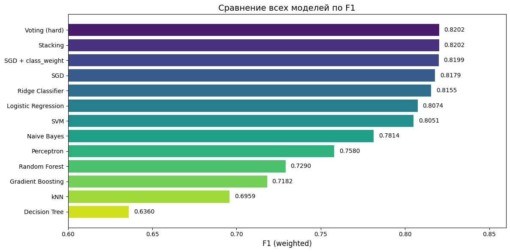
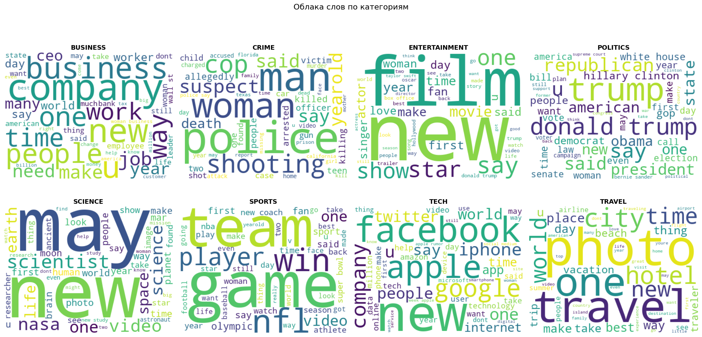
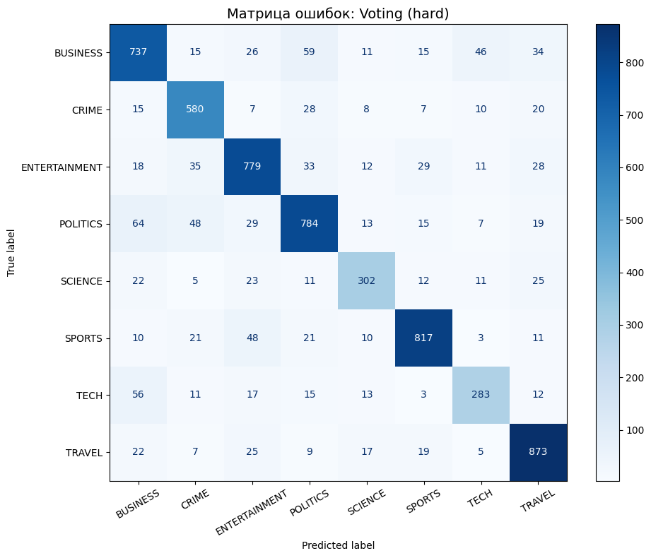

# Классификация новостей по темам

Модель, которая по заголовку и краткому описанию новости определяет ее рубрику: политика, бизнес, спорт, технологии и еще 4 темы. Данные: [News Category Dataset](https://www.kaggle.com/datasets/rmisra/news-category-dataset), около 210 тысяч новостей HuffPost за 2012-2022 годы.

Весь анализ в ноутбуке [`news_classification.ipynb`](news_classification.ipynb).

## Главное

- Лучший результат дают ансамбли из линейных моделей: accuracy 0.82 и weighted F1 0.82 на 8 классах. Голосование (Voting) и стекинг показали одинаковый F1 0.820.
- Одиночная SGD с весами классов почти не уступает ансамблям (0.8199). Ансамбли почти ничего не добавили, потому что все базовые модели линейные и ошибаются на одних и тех же новостях.
- На разреженной TF-IDF матрице линейные модели заметно сильнее деревьев: у случайного леса F1 0.73, у градиентного бустинга 0.72 при времени обучения около 5 минут против долей секунды у SGD.
- Лучше всего модель узнает спорт (F1 0.88) и путешествия (0.87), хуже всего технологии (0.72): их часто путают с бизнесом.
- Сжатие признаков через PCA или LSA до 500 компонент стоит около 0.05 F1, поэтому итоговые модели обучены на полной TF-IDF матрице.



## Данные и подготовка

В датасете 42 рубрики, но часть из них дубли после переименований на сайте (`WORLDPOST` и `THE WORLDPOST`, `ARTS` и `CULTURE & ARTS` и т.д.). Я их объединила и выбрала 8 рубрик, которые определяются предметом новости: `POLITICS`, `ENTERTAINMENT`, `TRAVEL`, `BUSINESS`, `SPORTS`, `CRIME`, `SCIENCE`, `TECH`. Рубрики вроде `BLACK VOICES` или `WOMEN` выделены по аудитории, а не по теме, поэтому их я исключила. `COMEDY` и `WEIRD NEWS` выделены по тону подачи, их тоже.

Классы сильно несбалансированы (`POLITICS` около 35 тысяч новостей, `TECH` около 2 тысяч), поэтому из каждого класса я взяла не больше 5000 примеров. Дальше:

- объединила заголовок и описание в один текст;
- удалила дубликаты и тексты короче 50 символов (обрывки вроде «MEH» или «SPLIT!»);
- привела к нижнему регистру, убрала все, кроме букв, удалила стоп-слова и лемматизировала через NLTK;
- построила TF-IDF на 10 000 признаков из слов и пар слов.

После очистки осталось 31 404 новости: 25 123 в обучении и 6 281 в тесте.



У каждой рубрики есть узнаваемые слова: police и shooting в `CRIME`, apple, facebook и google в `TECH`, nasa и scientist в `SCIENCE`. Матрица коэффициентов Жаккара по топ-200 словам показала, что сильнее всего пересекаются словари пар BUSINESS-POLITICS, BUSINESS-TECH и SPORTS-ENTERTAINMENT. Позже именно эти пары дали больше всего ошибок.

## Что я сделала

1. Обучение без учителя. K-Means и агломеративная кластеризация на PCA-представлении. Силуэт около 0.07: без меток тексты не делятся на четкие тематические группы.
2. 10 моделей с кросс-валидацией. Логистическая регрессия, Linear SVM, SGD, Ridge, Perceptron, наивный байес, kNN, дерево решений, случайный лес, градиентный бустинг. Сравнила по 5-fold CV на обучающей выборке и по тесту, засекла время обучения.
3. Настройка гиперпараметров трех лучших моделей по CV (выбирала по кросс-валидации, а не по тесту) через GridSearchCV.
4. Эксперимент с `class_weight='balanced'`. Дает небольшой прирост (+0.001-0.003 F1), потому что после undersampling `SCIENCE` и `TECH` все еще в 2 раза меньше остальных классов.
5. Ансамбли: Voting (hard) и Stacking из настроенных SGD, Ridge и логистической регрессии.
6. Снижение размерности: PCA и LSA на 50-500 компонент.

## Результаты

| Модель | F1 (weighted, тест) | Время обучения |
|---|---:|---:|
| Voting (SGD + Ridge + LR) | 0.820 | — |
| Stacking | 0.820 | — |
| SGD + class_weight | 0.820 | < 1 с |
| Ridge Classifier | 0.816 | < 1 с |
| Logistic Regression | 0.807 | ~2 с |
| Linear SVM | 0.805 | ~3 с |
| Naive Bayes | 0.781 | < 1 с |
| Random Forest | 0.729 | ~2.5 мин |
| Gradient Boosting | 0.718 | ~5 мин |
| kNN | 0.696 | < 1 с |
| Decision Tree | 0.636 | ~40 с |

F1 по рубрикам у лучшей модели:

| SPORTS | TRAVEL | CRIME | ENTERTAINMENT | POLITICS | BUSINESS | SCIENCE | TECH |
|---:|---:|---:|---:|---:|---:|---:|---:|
| 0.88 | 0.87 | 0.83 | 0.82 | 0.81 | 0.78 | 0.76 | 0.72 |



Самые частые ошибки: `POLITICS` → `BUSINESS` (64), `BUSINESS` → `POLITICS` (59), `TECH` → `BUSINESS` (56), `SPORTS` → `ENTERTAINMENT` (48) и `POLITICS` → `CRIME` (48). Почти все это пары, у которых больше всего общих слов. Слабее всего модель работает на `TECH` и `SCIENCE`: в них меньше всего примеров, а темы пересекаются с бизнесом, развлечениями и путешествиями.

## Ограничения и что можно улучшить

- Балансировка сделана до разбиения на обучение и тест, поэтому тест тоже сбалансирован. В реальном потоке новостей этих 8 рубрик `POLITICS` занимает около 44%, и метрики на нем могут отличаться. Правильнее сначала отложить тест, а балансировать только обучающую часть.
- Weighted F1 при почти сбалансированных классах близок к macro F1, но для несбалансированного теста лучше смотреть macro F1: он одинаково учитывает все рубрики.
- Разбиение случайное, а новости меняются со временем (новые имена, компании, события). Честнее проверить модель так: обучить на старых новостях и протестировать на более новых.
- TF-IDF не понимает синонимы и контекст. Следующий шаг: сравнить с эмбеддингами предложений (sentence-transformers) или дообученным трансформером вроде DistilBERT.

## Как запустить

```bash
pip install -r requirements.txt
jupyter notebook news_classification.ipynb
```

Датасет скачивается автоматически через `kagglehub` в начале ноутбука. Обучение всех моделей на CPU занимает больше получаса, дольше всего градиентный бустинг и случайный лес. Для раздела с PCA нужно около 3 ГБ свободной оперативной памяти.

Стек: Python, pandas, NumPy, scikit-learn, NLTK, matplotlib, seaborn, wordcloud.
